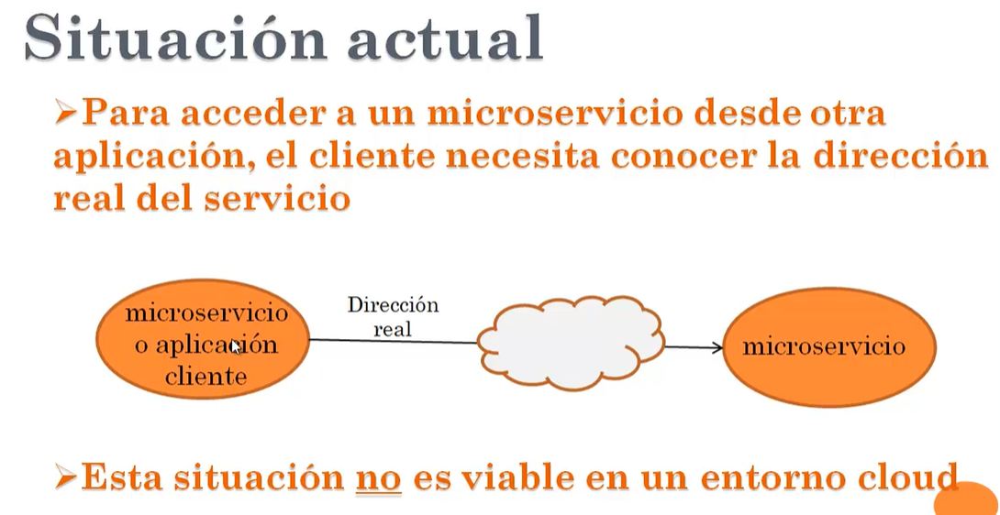
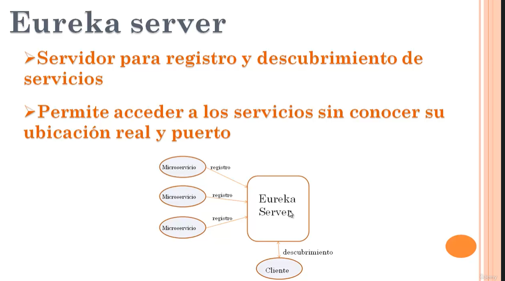
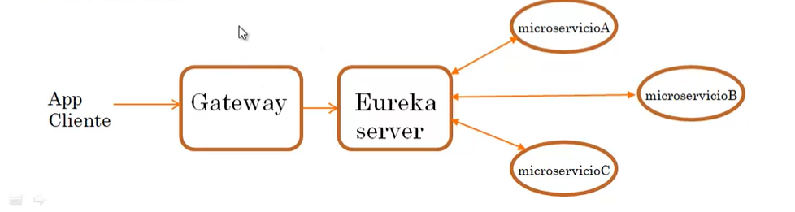
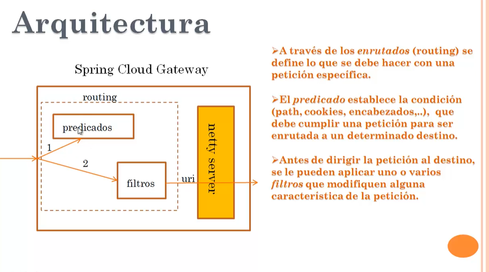

# 📦 Proyecto de manejo de ordenes de productos

Este proyecto referencia a todo los microservicios donde se puede acceder a los microservicios mediante eureka y también por medio de un spring cloud gateway

---

## 🚀 Tecnologías y herramientas

- Java 21
- Spring Boot 4.x
- R2DBC reactivo con mysql
- Maven 
- Base de datos: Mysql 
- Eureka
- Spring cloud gateway

---

## 🧪 Ejecución y pruebas de la Imagen del backend

# Levantar proyecto con IDE

## levantar el escenario de prueba
1. levantar eureka: http://localhost:8761/
2. levantar spring cloud gateway: puerto 7000
3. levantar proyecto de consulta de productos 1 (http://localhost:8000/) y 2 (http://localhost:9000/)
4. acceder mediante browser al file productos.html para probar en el bowser para probar con spring cloud gateway (https://github.com/sebashh26/client-test-products-front-js-v1)
5. levantar el proyecto de rasteador de productos con thymeleaf e ingrear al navegador: http://localhost:7000/

# Restaurar el script postgres: productos_productos 

## ARQUITECTURA CON EUREKA

## ARQUITECTURA CON SPRING GATEWAY

